<h1 align="center">Anemia</h1>

<p align="center">
  A VPN client that keeps working where VPNs are blocked —<br>
  the same engine and the same rules on <b>macOS</b>, <b>iPhone</b>, <b>Android</b> and <b>Windows</b>.
</p>

<p align="center">
  
  
  
  
  
</p>

<p align="center">
  <picture>
    <source media="(prefers-color-scheme: dark)" srcset="Docs/images/mac-main-dark.png">
    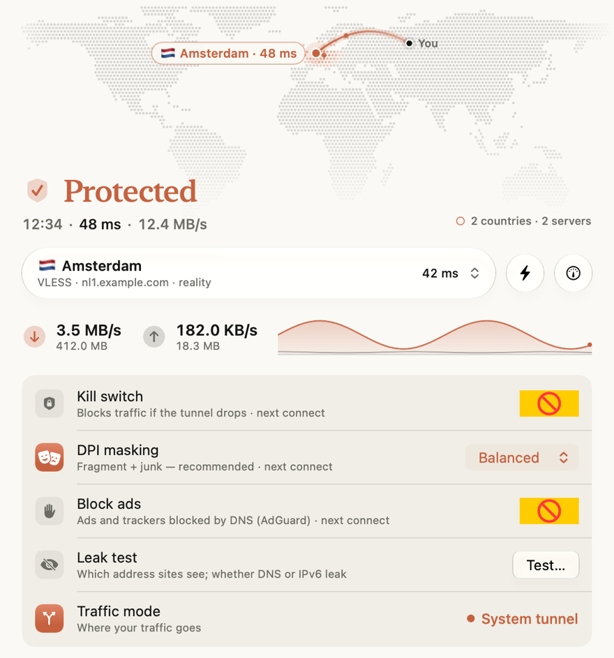
  </picture>
</p>

Traffic is made unreadable and hard to fingerprint with Xray's own anti-DPI
work — Reality / XTLS-Vision, a shredded TLS ClientHello, junk packets — while
staying fast on Apple Silicon. When a server stops carrying traffic the client
notices by itself, tries stronger masking, and moves on to the next server.

> Legitimate censorship-circumvention / privacy tool. You are responsible for
> complying with the laws that apply to you.
>
> **This repository holds the clients only.** The server side — the panel, the
> install and the user tooling — is not published here.

## How it works

<picture>
  <source media="(prefers-color-scheme: dark)" srcset="Docs/images/architecture-dark.svg">
  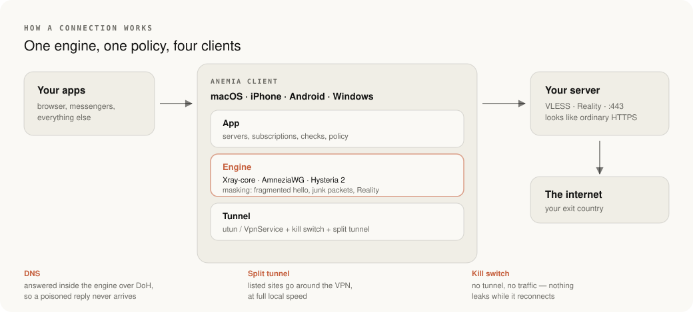
</picture>

1. **Everything on the device** goes into the tunnel: a utun on macOS, a packet
   tunnel on iPhone, `VpnService` on Android, a service on Windows.
2. **The engine dials your server** with the masking profile the server needs —
   and nothing else: no extra hop, no third-party relay.
3. **DNS is answered inside the engine** over DoH through the proxy, so a
   poisoned reply from the local resolver never arrives.
4. **Listed sites skip the VPN** (split tunneling) at full local speed, and the
   **kill switch** closes the door the moment the tunnel is gone.

## One core, four clients

<picture>
  <source media="(prefers-color-scheme: dark)" srcset="Docs/images/core-dark.svg">
  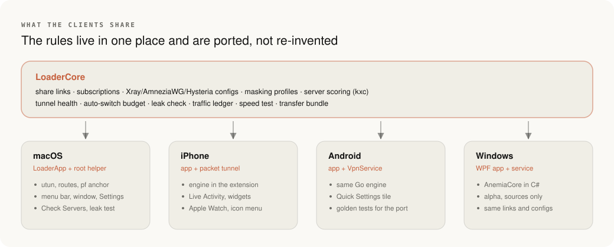
</picture>

| Platform | What runs the tunnel | State |
|---|---|---|
| **macOS** 14+ | `LoaderApp` + a privileged helper (utun, routes, pf kill switch) | in daily use |
| **iPhone** iOS 18+ | the app + a `NEPacketTunnelProvider` with the Go engine inside it | in daily use, signed on the device |
| **Android** 10+ | the app + `VpnService`, the same Go engine | working, verified against the Swift original |
| **Windows** | a WPF app + a privileged service | alpha, sources only |

## The Mac

<table>
  <tr>
    <td width="50%">
      <picture>
        <source media="(prefers-color-scheme: dark)" srcset="Docs/images/mac-servers-dark.png">
        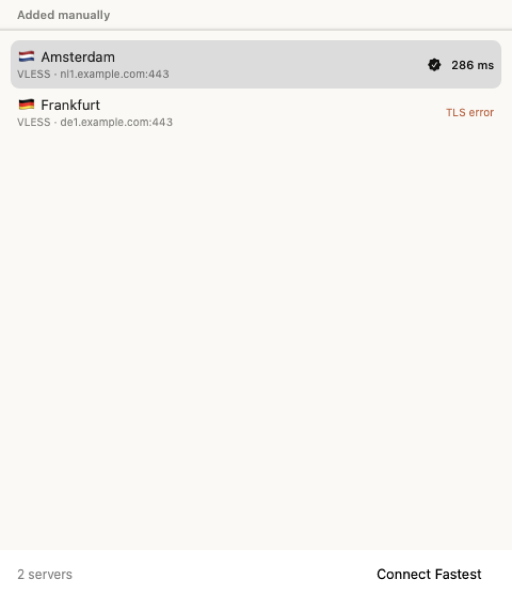
      </picture>
      <sub><b>Check Servers.</b> A throwaway engine makes one real request through
      every server, so the ones that answer pings but carry nothing are named and
      skipped. A blocked server is retried with stronger masking, and what gets it
      through is remembered.</sub>
    </td>
    <td width="50%">
      <picture>
        <source media="(prefers-color-scheme: dark)" srcset="Docs/images/mac-leaks-dark.png">
        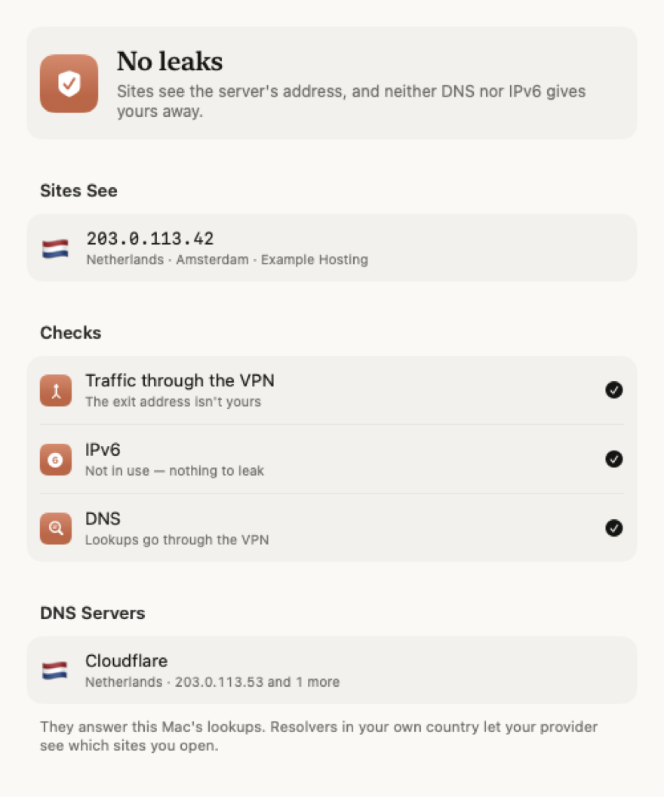
      </picture>
      <sub><b>Leak test.</b> What sites see, compared with the address your provider
      gave you (asked over the physical interface, around the tunnel), plus IPv6 and
      the resolvers that answer this Mac's lookups.</sub>
    </td>
  </tr>
  <tr>
    <td width="50%">
      <picture>
        <source media="(prefers-color-scheme: dark)" srcset="Docs/images/mac-stats-dark.png">
        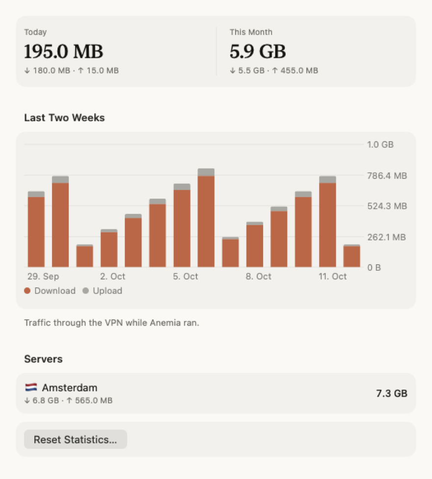
      </picture>
      <sub><b>Statistics.</b> What actually went through the VPN — today, this month,
      the last two weeks, and which servers carried it.</sub>
    </td>
    <td width="50%">
      <picture>
        <source media="(prefers-color-scheme: dark)" srcset="Docs/images/mac-speed-dark.png">
        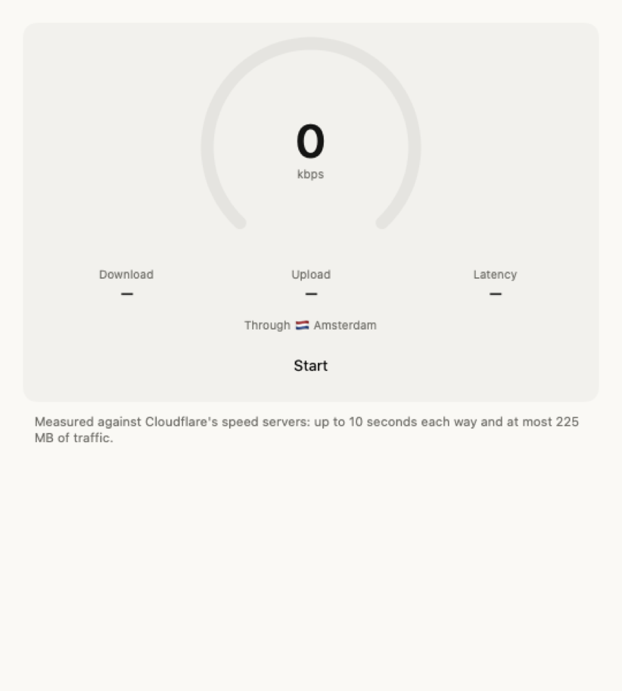
      </picture>
      <sub><b>Speed test.</b> Through the current connection, against Cloudflare —
      three streams, bounded to 10 seconds and 225 MB.</sub>
    </td>
  </tr>
</table>

## The iPhone

<table>
  <tr>
    <td width="33%">
      <picture>
        <source media="(prefers-color-scheme: dark)" srcset="Docs/images/ios-main-dark.png">
        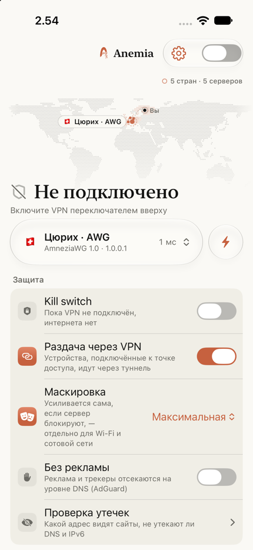
      </picture>
      <sub>The macOS window, translated to a phone: the map, the server bar, and
      protection as rows you can reach with a thumb.</sub>
    </td>
    <td width="33%">
      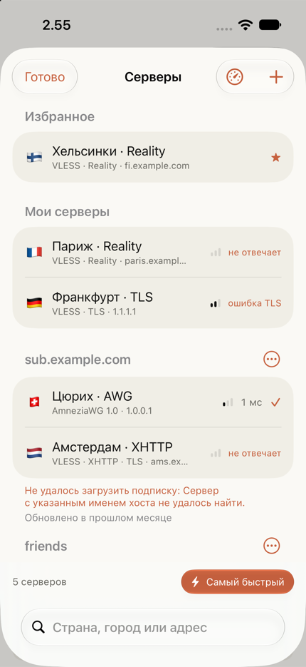
      <sub>Favourites, search, subscriptions, and the verdict of the last real
      check next to every server.</sub>
    </td>
    <td width="33%">
      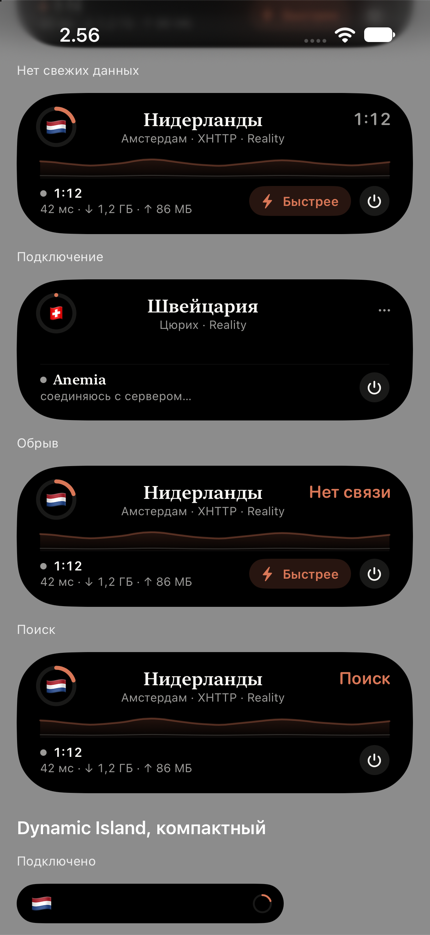
      <sub>The Live Activity keeps the country, the live speed, the graph and two
      buttons on the Lock Screen and in the Dynamic Island.</sub>
    </td>
  </tr>
</table>

<p align="center">
  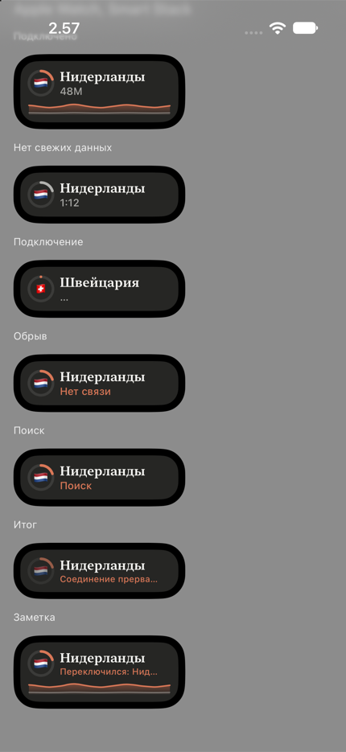
  <br><sub>The same session on an Apple Watch, in the Smart Stack.</sub>
</p>

The phone also carries the widgets, the Control Center switch, Siri phrases and
the icon's menu, checks servers and tests for leaks on its own, learns the
masking each server needs per Wi-Fi and per mobile network, and reminds you
before a subscription runs out. See [iOS/README.md](iOS/README.md) (in Russian).

## Android and Windows

* **Android** — [Android/README.md](Android/README.md): the Kotlin port of the
  core with golden tests against the Swift original, the same Go engine, a
  Quick Settings tile, and scripts that break a live session on purpose
  (deleting the interface, forcing Doze) to watch the recovery ladder work.
* **Windows** — [windows-version-alpha/README.md](windows-version-alpha/README.md):
  an alpha in .NET. `AnemiaCore` is the parsing and config layer, `AnemiaApp` the
  WPF window, `AnemiaHelper` the privileged service. Sources only; the build
  output is not kept in the repository.

## What it does

| | |
|---|---|
| **Protocols** | VLESS (Reality, XTLS-Vision, XHTTP, encryption), VMess, Trojan, Shadowsocks, Hysteria 2, AmneziaWG and plain WireGuard |
| **Masking** | profiles from off to “looks like Yandex”: ClientHello fragmentation, junk packets, uTLS fingerprints — learned per server and per kind of network |
| **Kill switch** | pf anchor on macOS, `includeAllNetworks` on iPhone: no tunnel, no traffic |
| **Split tunneling** | listed networks, addresses and domains go around the VPN, at both the OS and the engine level |
| **Block ads** | AdGuard DNS over DoH through the proxy |
| **Server choice** | latency history → the kxc Core ML forecast, plus a real request through each server |
| **Recovery** | health checks, a recovery ladder (same server → stronger masking → next server), network-change revalidation, a hold while there is no link |
| **Subscriptions** | traffic, expiry and the panel's notices; refreshes honour `profile-update-interval` and only over https |
| **Checks** | leak test (exit address, IPv6, DNS), statistics, speed test |
| **Transfer** | servers and settings move between devices as a file, a QR code or an `anemia://sync/…` link |

## Inside the macOS client

```
┌──────────────────────────────────────────────┐
│ LoaderApp  (SwiftUI window + menu bar)        │
│  • import vless/vmess/ss/trojan/hy2/awg links │
│  • XrayConfigBuilder → xray-core JSON          │
│  • XrayController: spawns `xray run -c cfg`     │
│  • NetworkHealthScan: finds broken leftovers    │
│  • HelperClient: XPC → privileged helper        │
└───────────────┬───────────────┬────────────────┘
                │ SOCKS/HTTP     │ XPC (code-signature verified)
                ▼                ▼
        127.0.0.1:10808   ┌──────────────────────────────┐
        (xray inbounds)   │ LoaderHelper (root daemon)    │
                          │  • utun + split routes         │
                          │  • tun2socks / amneziawg-go    │
                          │  • pf kill switch (own anchor) │
                          │  • DNS / proxy via the journal │
                          └──────────────────────────────┘
```

* **LoaderCore** — pure, unit-tested logic: share-link/subscription parsing and
  engine config generation (incl. anti-DPI). No UI, no root.
* **LoaderShared** — the XPC contract, the helper's LaunchDaemon definition and
  the network-safety policy shared by app and helper.
* **LoaderApp** — the client.
* **LoaderHelper** — privileged helper: utun, routing, bridge supervision, kill
  switch, and every persistent system change.

## Network safety

A VPN client must never leave a Mac offline — not after a crash, a force-quit,
a power loss or an uninstall. The helper (0.8.0+) guarantees it:

* **Journal before change.** System DNS and SOCKS proxy settings survive
  reboots, so every change is recorded — fsync'd — in
  `/var/db/Loader/network-journal.json` *before* it is made. Our own values
  (tunnel resolvers, engine proxy ports) are never recorded as the user's
  settings, VPN services of other clients are never touched, and an entry is
  dropped only after its restore verifiably landed.
* **Recovery at every launch.** The daemon starts at boot (`RunAtLoad`) and is
  respawned after a crash (`KeepAlive` → `SuccessfulExit=false`); each launch
  replays the journal, flushes the kill switch, kills orphaned bridges, drops
  dead routes and resets resolvers pinned to tunnels that no longer exist.
* **Kill switch in its own pf anchor** (`com.apple/000.AnemiaKillSwitch`): the
  main ruleset is never replaced, disarming is flushing one anchor, and the
  rules are validated by the real `pfctl` parser in the tests.
* **Watchdog + graceful SIGTERM.** A proxy pointing at a dead port or a
  resolver override without a tunnel is restored within 15 s; `launchctl
  bootout` / shutdown runs the full teardown.
* **Repair, with or without the helper.** Settings → Network safety → *Repair*
  (the main window and menu bar offer it automatically when the scan finds a
  broken leftover), or from Terminal:

  ```bash
  sudo bash Scripts/anemia-network-reset.sh
  ```

Details (in Russian): [Docs/network-recovery.md](Docs/network-recovery.md).

## Split tunneling (local bypass)

Settings → Split tunneling: networks and domains listed there use the regular
connection instead of the VPN — a local bank or government site that refuses
foreign IPs, a work network, a NAS on another subnet. One entry per line (or
pasted comma-separated):

```
10.8.0.0/16          # IPv4 network (host bits are cleared)
203.0.113.7          # single address
2001:db8::/32        # IPv6
bank.ru              # domain — subdomains included (*.bank.ru works too)
сбербанк.рф          # IDN, converted to punycode
```

It works on two levels, so it holds in every mode:

* **System tunnel (helper):** networks, and the current addresses of listed
  domains, are routed via the physical gateway — that traffic never enters the
  utun — and stay open under the kill switch. Domains are re-resolved on the
  60 s heartbeat and after network changes. Destinations on a directly
  connected link are left alone. The routes live in the kernel for the session
  only and are removed on disconnect.
* **Engine (Xray):** matching connections go to a `bypass` freedom outbound
  pinned to the physical interface — covering proxy-mode traffic and addresses
  a domain rotated to since. Without a detected physical interface the rules
  are omitted (an unpinned direct dial would loop back into the tunnel).

Entries that would defeat the VPN are rejected with a reason: IPv4 prefixes
shorter than /8 (IPv6 /16), loopback, and the tunnel's own ranges. The helper
re-validates every entry it receives. Changes apply on the next connect.

### Anti-DPI ("junk") mapping

| Requirement                | Xray feature                              |
|----------------------------|-------------------------------------------|
| Traffic can't be read      | VLESS + **Reality** + **XTLS-Vision** (TLS 1.3, real-site handshake mimicry) |
| Protect with junk          | `settings.noises` (junk packets) + `settings.fragment` (ClientHello shredding), both on the masking `freedom` dialer — xray has no `sockopt.noises` |
| Fast                       | XTLS-Vision splice, uTLS `chrome` fingerprint, large utun MTU + tun2socks TCP auto-tuning |

See `Sources/LoaderCore/AntiCensorship.swift` and a generated example in
`examples/sample-xray-config.json`.

## Checks, statistics and reminders

Shared with the iPhone app through LoaderCore (`LeakCheck`, `SpeedTester`,
`TrafficLedger`, `SubscriptionInfo`, `LearnedMasking`):

* **Check Servers** (Servers → ✓ seal): a throwaway `xray` per server (SOCKS
  inbound on a free port, server dial pinned to the physical interface — or
  through the tunnel while an armed kill switch allows nothing else) makes one
  real HTTPS request (`gstatic.com/generate_204`). Servers that answer pings but
  carry nothing are marked with the reason ("TLS error", "No response through
  the proxy"…) and drop out of the automatic pick and the failover ladder.
  Blocked TCP servers are retried with Maximum, then Yandex masking; what gets
  one through is learned. WireGuard-family and Hysteria servers keep their
  ping. The engines are killed at quit (`ProxyCheck.stopAll`).
* **Learned masking per network:** kept per server *and* per kind of network —
  `identityKey#wifi` (Wi‑Fi/Ethernet) and `identityKey#cellular` (mobile data;
  an iPhone hotspot is an expensive path and counts as one); the plain
  `identityKey` entry is the fallback. The same keys travel to and from the
  iPhone in transfer bundles.
* **Block ads** (main window, Settings → Protection): the engine's DNS asks
  AdGuard DNS over DoH through the proxy (its host pinned in `dns.hosts`);
  AmneziaWG sessions point the system resolver at AdGuard instead of the
  profile's DNS. Effective under the system tunnel; applies at connect.
* **Leak test** (main window, ⇧⌘L): the exit address (ip.sb, Cloudflare as a
  fallback) through the VPN — via the engine's SOCKS port in proxy-only mode —
  compared with the provider's own address, fetched by `curl --interface
  <physical NIC>` around the tunnel (an armed kill switch blocks that, and the
  test then says so); IPv6; DNS resolvers via bash.ws.
* **Statistics** (click the traffic strip, ⌘Y): today, this month, two weeks,
  top servers — fed by the stats poller; plus a **speed test** against
  Cloudflare (3 streams, ≤10 s or 150/75 MB each way).
* **Subscriptions:** traffic, expiry, title, announcement and links from the
  panel's headers, in Settings and the server list; a notice with **Renew**
  when the selected server's subscription is about to run out; reminders
  three days and a day before it ends and at 90 % traffic (provisional
  notifications first; Settings offers banners). Automatic rounds — the
  launch refresh and the 6-hourly one — fetch only `https://` panels and log
  the skipped ones: a plain-http answer is written by whoever controls the
  path, and a swapped server list is tomorrow's traffic through someone
  else's exit. A panel is also left alone until its own
  `profile-update-interval` has passed — honoured on iOS, where the round runs
  every half-hour and on any return to the foreground; on macOS the round
  itself runs every 6 h, so a panel asking for hourly still waits 6 h, and a
  panel asking for a month is never allowed past 24 h. **Refresh Subscriptions**
  and the per-subscription button load http too, because that's a press you
  made; rows for unencrypted panels carry an open-lock mark. The decision is
  one function (`Subscription.refreshIsDue`) shared with the iOS store and
  mirrored byte-for-byte in the Kotlin port.

## Transfer to iPhone

Settings → General → **Transfer to iPhone** moves the servers added by hand,
the subscriptions (their addresses — each device fetches the lists itself)
and the shared settings (masking, kill switch, split tunneling, learned
masking, block ads) to Anemia on an iPhone or another Mac, and back:

* **Share…** (AirDrop, Messages…) or **Save File…** writes an `.anemia` file;
  **Show QR Code** shows a code the iPhone scans (Servers → + → Scan QR).
* **Import File…**, or paste an `anemia://sync/…` link / drop an `.anemia`
  file into Import: a preview says what's new; servers already present (same
  endpoint and key) aren't duplicated, settings are taken only when asked.

The format is `LoaderCore/SyncBundle.swift` (JSON; the link form is
base64url of zlib-deflated JSON). The selection stays per device. The file
holds server keys — don't publish it.

## Build & test

```bash
bash Scripts/test.sh        # every suite (swift-testing), Xcode or Command Line Tools
bash Scripts/build-app.sh   # release, arm64 → /tmp/Anemia.app

bash iOS/Scripts/build-ipa.sh            # iOS/build/Anemia.ipa (sign it on the device)
bash Android/Scripts/build-apk.sh        # Android APK
bash windows-version-alpha/Scripts/test.sh   # the .NET suites
```

The scripts adapt to the standalone Command Line Tools: they pin a pre-27 SDK
when the SwiftUI macro plugin is missing, and point the Swift Build engine at
the swift-testing macro plugin (the CLT ships no XCTest).

> **Note:** this project lives under `~/Documents`, which is iCloud-managed and
> stamps freshly-built bundles with extended attributes that `codesign` rejects.
> The scripts build in `/tmp/loader-build` (override with `SCRATCH=`).

## Running the engine (dev)

The app needs an `xray` binary. For development, point it at a local install:

```bash
export LOADER_XRAY_PATH=/opt/homebrew/bin/xray
```

Or bundle it into `Resources/xray` for a release build (see
`Scripts/fetch-cores.sh`).

## Dev testing (helper)

The system tunnel needs the privileged helper registered with launchd. The app
installs it itself (Settings → Privileged helper); for an unbundled dev build:

```bash
swift build --scratch-path /tmp/loader-build
sudo bash Scripts/install-helper-dev.sh      # installs LaunchDaemon + tun2socks
export LOADER_XRAY_PATH="$PWD/Resources/xray" # so the app finds the engine
# run the app, import a real server, Connect
sudo bash Scripts/uninstall-helper-dev.sh    # restores the network, removes the helper
```

## Status

- [x] LoaderCore: parsing (vless/vmess/ss/trojan/hysteria2/AmneziaWG) + subscriptions
- [x] LoaderCore: Xray config builder with Reality/Vision + fragment + noises + mux
- [x] Config validated end-to-end against real Xray v26.3.27 (`xray run -test`)
- [x] Persistence (servers, subscriptions, selection, anti-DPI options)
- [x] XrayController (process supervision, log streaming, native Stats API)
- [x] Helper: utun + split-default routing + tun2socks bridge, IPv6 anti-leak
- [x] Kill switch (pf anchor, fail-closed, stateless rules)
- [x] Network-safety journal, launch recovery, watchdog, graceful SIGTERM
- [x] Network repair (helper XPC, admin-prompt fallback, standalone script)
- [x] XPC client code-signature verification
- [x] Ping-on-launch → auto-connect fastest; kxc v4 Core ML ranker — forecasts each server's next probes (`bash Scripts/train-kxc.sh --install` retrains, evaluates and installs only if it beats every baseline)
- [x] Post-connect health check, recovery ladder, network-change revalidation
- [x] Apple Silicon: arm64 release build with cross-module optimization; engines
      thinned to arm64; packet path (tun2socks / amneziawg-go) at user-interactive QoS
- [x] Check Servers (real requests via throwaway engines), leak test, statistics, speed test, block ads, subscription info and reminders, learned masking per network
- [x] swift-testing suites (276 tests) runnable without Xcode
- [x] iPhone client: packet tunnel with the Go engine, Live Activity, widgets, Control Center, Siri, Apple Watch — signed on the device
- [x] Android client: `VpnService` with the same engine, the core ported to Kotlin with golden tests, recovery verified by breaking a live session
- [ ] Windows client: alpha (sources build and run; not yet proven over a long session)
- [ ] Developer ID code signing + helper install via SMAppService
- [ ] Verify the full system tunnel end-to-end as root against a live server
